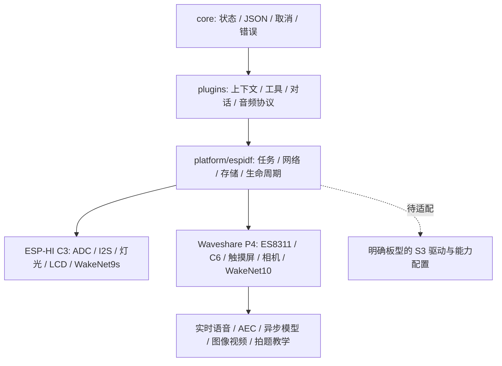

# COGD 共享架构

2026-11-06。当前候选产品设计以 P4 `0.9.4-p4-tutor` 为基线，芯片适配按资源与真实外设裁剪。[P4 的实现、状态机和资源细节](ESP32-P4-WIFI6-Touch-LCD-3.5/ARCHITECTURE.md)是当前功能参考；历史 C3 实验不能替代这份设计。本轮区分新采集与同图选题，来源检查已通过，用户确认新拍题正常；“重新读题”首次误路由仍保留。完整语音验收由用户延期，最终应用/资产/分区读回与正常监听核验已通过，见 [来源修复报告](docs/TUTOR_CAPTURE_SOURCE_20261106.md)。[0.9.3 七项报告](docs/TUTOR_FIXES_20261106.md)保留历史镜像和范围。

## 共享与独立部分

| 层 | 当前路径与责任 |
|---|---|
| 核心与协议 | `core/`、`plugins/`：事件、错误、工具、上下文 WAL/CRC、JSON、模型协议、音频生命周期。两种固件编译同一份源文件。 |
| ESP-IDF 适配 | `platform/espidf/`：任务、TLS/WebSocket、NVS、Flash、串口、对话资源所有权。 |
| 实时能力 | `plugins/speech/audio_session.*` 管理连接/回复代数；`platform/espidf/p4_conversation.*` 目前仍依赖 P4 能力与 PSRAM，未来 S3 移植需先提供对应接口，不能仅改宏。 |
| C3 板级 | `boards/esp_hi/`、根 `components/agent_speech/`；官方 WakeNet9s，无 PSRAM。历史自研模型仅显式兼容构建。 |
| P4 板级 | `ESP32-P4-WIFI6-Touch-LCD-3.5/board/`、`components/p4_board/`、`components/p4_media/` 与其唤醒组件；P4 工程复用根 main/components。 |
| 构建 | `tools/build.ps1 -Board ...` 选择独立工程；分区、SDK 配置、模型和固件输出按板型隔离。 |

当前并非已完成任意芯片的通用 HAL：音频公共控制仍位于 `boards/esp_hi/audio_board.c`，P4 扩展工具通过 `p4_agent.h` 的窄 C ABI 接入，共享代码中保留 `AGENT_BOARD_P4` 条件编译。这是明确的移植边界，不能把 S3 标成已支持。

## 产品契约

1. 待机本地唤醒，不以持续上传环境音代替本地唤醒。统一唤醒词为官方“你好小智”，芯片使用各自官方模型与默认阈值。
2. 音频采播与网络/后台任务分开；音频任务不得等待重型云任务。P4 的 AEC、确认后插话和音频缓冲让路策略是后续扩展的参考。
3. 工具参数必须校验，副作用不能因重连或重复回执而重复执行；慢任务先受理、完成后再通知。未安装的能力应明确不支持。
4. start 创建新相机捕获，refine 只引用当前待确认照片并校验题号/版本；来源、capture_id、照片哈希和时间随回执传递。新拍摄不能被旧历史或状态查询替代。上下文继续通过既有 WAL/CRC/双 bank 恢复。教学图片/解法独立保留于 RAM，以题号和版本匹配文档及阅读位置。求解中保留用户读/讲选择，完成后遵从，只有未选择才询问一次；临时通知只播当前结果，不成为新的操作授权。
5. 普通 P4 会话约 30 秒静默告别；教学阅读/讲解使用五分钟用户活动计时，安全空闲时静默续接云连接，暂停后回到本地唤醒。
6. 能力与验收按板型记录。C3 保留资源允许的串联语音链路、上下文和硬件工具，不承诺 P4 的全双工实时、多媒体和教学 UI。

P4 曾有偶发非预期打断，尤其出现在视频并发和结题收尾；根因未证实。0.9.2 整合教学复测还记录了音频欠载与发送期限超时，详见整合报告。0.9.3 的七项教学修复不改变这些未通过项，整体验收仍未通过；固定回放和软件滚动不替代真人、现场触摸、远场/噪声或耐久验收。

## 移植与验证

新增板型按 [PORTING.md](docs/PORTING.md) 扩展，禁止通过硬编码别的板名绕过能力检查。主机回归验证共享契约，独立编译验证每个芯片的链接/资源，实机验收绑定该板型构建与 Flash 读回哈希。结果见 [整合报告](docs/INTEGRATION_20261106.md)。
