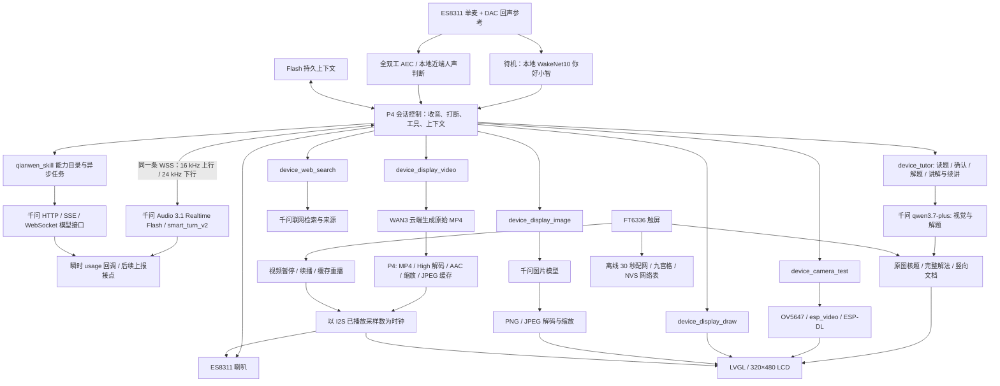

# COGD P4 当前架构

0.9.2 教学候选更新：复用 `device_tutor`、现有云工作线程与 LVGL 文档，增加独立保留的当前题解法、版本、讲解/阅读状态及步骤锚点。解题后先询问讲解方式，追问只读取当前题的对应片段；其他模型结果不会覆盖教学材料。用户语音/触摸刷新五分钟活动计时，超时静默暂停。阅读中约 150 秒无会话活动时，在安全空闲边界静默续接云连接，避免服务端 180 秒无回复的期限提前结束阅读；续接不重置五分钟计时。教学核心用例通过，**视频并发仍出现本地 VAD 误打断，整体验收未通过**；该机制已从事件确认，声学根因未证实。见 [教学对话报告](TUTOR_DIALOGUE_REPORT.md)，诊断版未复现不能替代候选 06 的失败结果。

0.9.1 音频优先更新：播放任务继续使用最高应用优先级，采音/AEC 与云端、UI 工作者分开。去掉用静音试探插话的路径，采用乐鑫 `AEC_MODE_FD_HIGH_PERF`，在持续播音时比较最近 96 ms 的参考历史，在 12 帧内累计 6 帧独立语音，并要求至少 2 帧经增益归一后的强语音证据；起声后 900 ms 为滤波器稳定期。确认事件按当前输出话轮保留，网络收包较久也不会因超过旧 110 ms 门槛丢掉；后续回复以开始时间隔离旧事件。语音 PCM 余量不足 500 ms 时，视频准备、图片解码、摄像头预览/推理的下一批重工作让路，随后继续。视频 Flash 擦写拆为不超过 4 KiB 的片段并让出调度。首播预缓冲仍为 80 ms，500 ms 是后台放行参考值。

`agent voice realtime` 记录实际播放期间的最大供音间隔和超过 90 ms DMA 容量的次数，每流计算并按会话保留峰值/累计次数；后续视频不能覆盖语音记录，告别或插话后合法的静默不计为卡顿。0.9.1 的连续性基线见 [音频优先报告](AUDIO_PRIORITY_REPORT.md)；新版结果单独记录，不将旧固件测试算作新版重跑。

更新：2026-11-06。实物为 **ESP32-P4-WIFI6-Touch-LCD-3.5**。P4 直接连接千问，无电脑会话代理。待机仍用官方“你好小智”，不上传环境音。普通会话 30 秒静默后由同一音色告别；拍题读题、等待确认、解题和后续阅读/讲解不触发这个闲聊超时。参见[教学对话实现与测试](TUTOR_DIALOGUE_REPORT.md)、[原拍题测试](TUTOR_REPORT.md)、[音频基线](AUDIO_REPORT.md)及[实施方案原件](docs/ESP32P4_千问实时语音终端实施方案.docx)。

## 设备与云端的分工

P4 运行 COGD 的对话状态机、工具调度、短期与持久上下文、本地唤醒、音频采集播放、摄像头采集和小型视觉模型，以及 LCD 渲染。千问等大模型的权重在云端，设备直接调用接口；“装 skill”在这里是安装能力说明、请求模板和调度接口，不是把大模型权重放进 32 MiB PSRAM。



正常设备交互不需要电脑后台服务。仅离线配网使用明确的触屏界面；视频直接点画面控制，没有播放按钮。Insta360 接在电脑上，只用于观察 LCD 的实拍验收；它不是板载视觉输入。验收画面旋转 180°，P4 屏幕方向保持原样。局域网素材服务器只送未经改动的测试文件，不是产品依赖。

## 代码边界

| 位置 | 责任 |
|---|---|
| `../core/` | COGD 核心状态、事件、错误与取消契约 |
| `../plugins/llm/engine.c` | 规划、工具调用、状态查询、最终回复；语音分阶段输出；持久上下文重放；P4 当前硬件快照 |
| `../plugins/llm/deepseek.c` | 原有文字及兼容模式的主 LLM 的 OpenAI 兼容请求与流式解析，模型 ID 为 `deepseek-flash` |
| `../plugins/tool/tools.c/.h` | 共用工具注册、参数校验、调用分发；P4 在现有音频工具基础上增加 7 个工具 |
| `../plugins/speech/` | ASR、路由候选校验、语音前缀与输出生命周期 |
| `../plugins/model_usage.c/.h` | 提取原始用量及请求标识，同步借用回调；不保存或推算费用；C3 为无操作宏 |
| `../platform/espidf/runtime.c` | ESP-IDF 任务、配置、串口控制、语音模式及共享资源所有权 |
| `../platform/espidf/p4_conversation.c` | 唤醒后的实时连接、音频流、事件与后台工具；使用原有网络任务 |
| `../plugins/speech/audio_session.c` | 连接代数、响应 ID、迟到音频与重复工具调用的门控 |
| `../platform/espidf/voice_candidate.c` | 兼容模式的路由候选；在该模式中 P4 使用经校验的候选文本，交给统一 TTS 发声 |
| `board/hardware.c` | 实物能力说明和硬件快照，不把 C3 的灯光/GPIO 能力冒充成 P4 外设 |
| `board/display_board.c` | 原有时钟、颜色显示及新画布的所有权切换；不改屏幕旋转 |
| `components/p4_board/p4_vision.cpp` | 摄像头、视觉推理、画布、几何绘制、中文标签、PNG/JPEG 显示 |
| `components/p4_board/p4_cloud.cpp` | 固定千问 API 源、联网搜索、异步图片/视频任务、拍题确认与解题、通用模型调用和结果分页 |
| `components/p4_board/p4_wifi.cpp` | 30 秒离线检测、扫描排序、九宫格键盘、最多 8 个成功网络、重连优选 |
| `components/p4_media/` | minimp4、OpenH264 2.6.0、AAC 解码、本机视频准备与同步播放 |
| `components/p4_board/p4_audio.c` | ES8311/I2S 收发、真实 DAC 参考回声消除、输入/输出增益及 DMA 完成采样时钟 |
| `components/agent_speech/speech_wakenet.c` | 官方 P4 WakeNet10 适配原有 speech_backend 接口；模型装载、检测与资源诊断，不另建对话状态机 |
| `components/p4_board/p4_agent.h` | C11 核心与 P4 C++ 功能之间的窄 C ABI |
| `components/p4_board/qianwen_catalog.json` | 45 个能力配置与模型目录快照，可从平台刷新模型 ID |
| `components/p4_board/vision.compile_req.yml` | 补齐旧视觉组件缺失的 ESP-DL 算子/内核声明，避免被语音组件裁剪掉 |
| `experiments/video-native-probe/` | 临时独立解码基准，不属于发布固件，不是产品视频播放器 |

尽量复用现有 engine、工具表、上下文和音频生命周期。视觉和云端工具集中在两个 P4 实现文件中，视频编解码集中在 p4_media 组件；没有另建第二套对话引擎或电脑代理服务。C3 分支仍使用原来的工具数量与硬件适配。

上下文继续使用 Flash WAL、CRC 和双 bank 恢复，持久区预留 2 MiB。当前历史预算为 200 KiB，最近记录索引最多 128 条，摘要上限 1,536 字节；它们是字节/记录预算，不是固定轮数或云模型最大上下文。自然模式在同一云会话请求最多 20 个历史话轮；新建连接时，板端从已保存资料、摘要与近期最多 8 条消息裁出上限 6,500 字节的参考文本。后者不等于可以原样恢复 20 轮录音。模型回执的 input/prompt token 才是该次实际报告的计量。

## 摄像头与内存调度

原摄像头任务独占采集和预览。识别模式在同一实现文件内启动一个低优先级推理任务，使用一个完整 RGB565 快照；前一次完成后才提交下一帧，没有随时间增长的识别队列。预览按独立时限运行，缩放在 LVGL 锁外，持锁只复制画面并更新必要标记。退出时先等推理任务结束，再释放输入与模型，避免切换到绘图或视频后访问旧画布。

标记保留帧的采集时间，超过 700 ms 或画面质量不足即清除，并重置面朝/靠近的时序状态。仍保持完整 800×640 视野，按比例显示为 320×256；双线性缩放不能恢复传感器未采到的细节。真实眼球视线、距离测量及已录入身份识别均未因此新增。

摄像头预览额外使用 192,000 B PSRAM；识别再使用 1,024,000 B 快照和 8 KiB PSRAM 栈，退出释放。普通 malloc 优先 PSRAM，内部预留 64 KiB，明确要求内部/DMA 的分配保持内部。TLS 加密和原 SDK 不改；`agent status` 同时报告内部堆、PSRAM、DMA 空闲与连续块，避免总空闲很多却分配不到 8 KiB DMA 缓冲的问题。

## 唤醒、插话与连续对话

1. 待机由本地 WakeNet10 监听。唤醒后响提示音，麦克风通过有界 PSRAM 环形缓冲把 PCM 交给原来的网络任务；音频线程不等待网络。
2. 默认 `natural` 模式保持一条经证书校验的千问连接。`smart_turn_v2` 决定何时回答；原生音频回复统一使用 `longanqian_v3.1`。板端使用真实 DAC 参考做全双工消回声。播报时持续做本地收音和插话确认；确认前向云端发送等长静音，避免残留回声被认成用户，喇叭继续正常播放。确认后恢复上行，并从原有采音环缓冲补送最多 750 ms 的人声起始段。
3. 播放与输入并行。插话时清队列，统计 DAC 播放进度，屏蔽旧 response 的后来音频。取消只针对当前正在生成的回复；打断不取消已经执行的工具。服务不支持精确截断音频项，故删除被打断的整个助手项，记录“未完整播出”，不猜测听到了哪个字。
4. 按输入 item ID 接收迟到的最终转写，已播放的结果写入已有 COGD 上下文。新连接读入用户资料与近期话轮，不把旧工具记录和中断标记当台词。空闲 30 秒时由原音色告别并关闭上传。后台通知等当前话轮和音频结束后再说，不写入真人发言记录。真实掉网只自动重连一次，不重投旧音频、旧任务或有副作用的操作。
5. 问答不需要额外的 ASR、路由 LLM 和 TTS 三次调用。原路径保留用于 USB 文字和显式 `fast` / `classic` 兼容模式。`agent voice realtime` 查看当前模型、采样、会话代数、轮次与打断数据。

播音时，采集线程在同一时钟上比较麦克风、DAC 参考与 AEC 输出，排除与参考声相关的残留回声。在最近 12 帧中累计至少 6 帧有效独立语音，允许音节间短暂停顿；每帧 32 ms。仅在确认后取消当前播音，不再先静音试探。长回复的旧音频阻塞新输入时，有条件切换实时连接：只保留本次插话的短音频，先关闭旧连接，再建立新连接。已确认的问题从原有上下文恢复，不再执行旧工具。常态单连接；这个分支与 Wi-Fi 掉线恢复分开计数。空闲环境中的本地噪声候选不会反复延后 30 秒告别，正式语音事件仍更新活动时间。

0.8.1 下行 PCM 由现有音频任务直接读取 45 秒容量的 PSRAM 环缓冲。网络任务只解码、检查剩余容量并原子发布新样本；取消后先等音频任务归还缓冲，再重用或释放。去掉 8 KiB 中转环和每次最多转交 80 ms 音频的限制，TLS 等待不再截断已有的待播音频。启动只需 80 ms 音频，容量不等于播放延迟；功放在云端开始生成时以静音预热。没有新增音频任务、服务或 UI。

开发诊断 `agent voice endpoint 0` 使用默认语义判停；`200..800` 切换为对应毫秒的 `server_vad`。只能在语音关闭且空闲时调整，不写 NVS，重启恢复默认。短静音参数会增加句中停顿被拆开的风险，不能作为 500 ms 端到端回复的承诺。`agent voice realtime` 分开记录播放断粮次数、网络处理最大耗时及首音时间。

工具仍以本机原有校验为准。千问有时把绘图数组或模型请求对象作为 JSON 字符串返回；适配层只对这两个已知字段按类型解包。相同话轮内相同操作复用原回执，每轮工具尝试设上限。快工具返回实际执行结果，慢工具返回受理回执；两者都在原播报排空后，逐条等待服务端确认再创建续答。旧用户话轮的迟到回执不会创建额外续答。意外提前到达的新 response 先等待旧 PCM 播完，不清空待播数据；真实用户打断仍可取消播音。播放中插话不会顺带取消已经受理的后台工作。

0.9.0 的 420 ms 静音确认方案已移除。0.9.1 起声后的 900 ms 内暂不接受本地人声打断，给消回声滤波器留出稳定时间；这也限制了刚开口播放时的插话速度。回声、轻声和不同摆位仍需实测，不能将固定音源回放描述为任意真人条件下的保证。

## 拍题教学

只新增一个工具 `device_tutor`，复用已有摄像头任务、云任务入口和 LVGL。`start/refine` 打开 800×640 预览，采集新鲜完整帧，以质量 90 的 JPEG 送给千问 qwen3.7-plus 读题；本地先拒绝过暗、过曝、缺少细节的图像。读题关闭思考模式，要求结构化题干和摘要，最多 3 次读题请求、45 秒采集窗口；仍不清晰则提示调整后重看，不虚构题目。

读题成功进入 `awaiting_confirmation`，每次产生新的 `question_id`。`refine` 按用户描述重新看图选题并再次确认。`confirm` 必须匹配当前题目与画布 generation；原会话还要求确认来自后续用户话轮，不能在发起拍题的同一轮自行确认。未确认、旧编号、取消后、重复确认均不启动解题。确认时关闭摄像头，显示“正在解题中”，保留确认时的原图和题干送往同一模型解题；开启思考并设置 4096 token 推理预算，只显示最终教学步骤，不显示内部推理内容。

解法直接送往屏幕，不塞进 2304 字节的工具回执。按小段标签排成竖向长文，LVGL 原生触摸滚动，关闭首尾弹性越界；排版没有固定页数。资源防线为 128 KiB UTF-8 正文、每次 8192 输出 token、最多 4 次有明确截断证据的续写；到达资源限制或失败会明确标记“未完整完成”，不会把截断内容标成完整答案。数学符号、希腊字母、上标与常用符号已补入字体范围。当前是普通文本公式，不是 LaTeX 数学排版器。

题目图片和解法只在运行内存中，工具回执与 usage 沿用现有瞬时回调。`tutor_solution` 独立于通用模型返回体，保存一份当前完整解法；`revision` 区分成功复核后的版本，`question_id` 区分题目，`step_numbers` 列出实际正文的步骤编号。`context/explain` 按标题与字节偏移回传有界片段，`read/resume/done` 更新同一教学状态。若其他画面替代了解法，续讲可恢复保留的正文；重启、取消或换题不保留旧教学材料。只读 `agent tutor status` 可在实时语音运行时核对实际状态。

复核失败时，后台任务保留失败回执，旧完整解法、版本、题号和当前步骤不被部分答案替换；课题仍可继续，状态转为暂停并标记 `last_recheck_error`。旧页面尝试从顶部恢复，恢复失败则下次阅读/讲解重绘。首次求解失败没有旧版可用，明确标为未完成。该错误恢复路径尚未做故障注入实测。

文档标题同时用作步骤锚点；`visible_step` 反映可见位置，显式步骤追问可定位正文。触摸与手动滚动更新活动时间，短时间内优先保留手动位置。明确“懂了/不用讲了”才进入 `done`；沉默超时进入 `paused`，不是掌握标记。新的语音连接注入当前题与教学状态，完整解法仍按需读取，不把 128 KiB 全文塞进实时提示词。

取消或改成新画布后，以 generation 阻止旧读题/解题结果覆盖新内容。已提交的云请求可能仍在服务端完成，不会因取消而自动重提。全机仍只同时运行一个重型云任务，其他重型请求返回 busy；本地绘图、音量和实时语音可继续。联网搜索使用既有云工作线程，不阻塞公共工具执行线程。教学没有新增工作线程、云服务或第二套语音状态机。

## 自然语言到硬件

| 用户表达示例 | 工具与行为 |
|---|---|
| “摄像头测试，人望向摄像头时显示效果” | `device_camera_test` 的 `attention` 模式，显示实时画面、框线、关键点和文本日志 |
| “测试人形检测” / “测试人靠近” | `person` / `approach`；人形检测与单目目标面积变化趋势 |
| “测试人脸识别” | `recognition`；显示人脸检测基础，并明确未录入身份 |
| “画一个蓝色圆，写上你好小言” | `device_display_draw`，本机绘制矩形、圆、线、中文文本 |
| “把音量调到五十／一百／零／恢复到八十” | 复用 `device_audio_volume` 的 `percent:0..100`；0 静音，麦克风继续工作，可语音恢复 |
| “生成一张小猫的图片，显示出来” | `device_display_image`，调用千问图片模型、等待任务结果、下载和显示 |
| “显示这张照片”并给图片 URL | 同一图片工具下载 PNG/JPEG 并保持比例显示 |
| “联网查一下……” | `device_web_search`，强制联网，返回摘要和有索引的来源 URL |
| “生成并播放一段小猫踢足球的视频” | `device_display_video`：只提交一次 WAN3，轮询任务，设备独立准备并自动播放 |
| 调用某个千问能力/模型 | `qianwen_skill` 的 `list/describe/models/run/status/poll/result` |

“绘制”走本机图元，“生成图片”走云端图片模型。工具结果驱动回复，不把“任务已提交”说成“图片已显示”。用户提出新内容时，以画布 generation 使旧任务失效，防止旧图稍后覆盖新指令。

## 视觉基础与边界

- OV5647 通过 MIPI CSI/ISP/V4L2 采集，当前配置为 800×640 RGB565、双采集缓冲；推理/预览节流至约 5 Hz。
- 人形使用 `pedestrian_detect 0.3.3`；人脸和五点关键点使用 `human_face_detect 0.5.2`。模型按需创建，关闭摄像头后释放。
- ISP 处理控制器已启用；当前 OV5647 默认配置没有加载 ESP-IPA 的 AGC/AWB 模块。2026-11-02 晚间实测传感器 `0x3503=0x00`、`0x5001=0x01`，使用传感器内置自动曝光/增益与白平衡，不能把外部 AGC 查询不支持当成内置自动曝光关闭。过暗、过曝或缺少亮度细节的帧标记 `image_usable=false`；该基础检查不等于图像已达到识别质量，暗光下出现了无法从画面确认的人形大框。
- 人形阈值从 0.7 调至 0.5，固定多人样图从 1 人增至 3 人；严重裁切的人物仍漏检。试验性 0.3 没增加检出，却在负样图产生 2 个误报，已撤销。
- `approach` 比较约 1.5 秒内同一区域的框面积变化，是靠近趋势，不是厘米级测距或已验证的身份跟踪。
- `attention` 用眼角、鼻子等五点结构判断粗略面朝方向。0.6.1 检查全部检测到的人脸，连续 3 次有脸满足时给候选，避免高分侧脸掩盖另一张正脸；这不是同一身份的连续跟踪。`eye_gaze=not_measured`：没有测量眼球视线。
- `recognition` 尚无注册人脸、特征库和身份匹配，始终明确 `identity=not_enrolled`。本轮实现的是后续身份识别的采集、检测与关键点基础。
- 图片回放测试有 `source=test_image_not_camera` 标记；不能把静态图片检出算成真人靠近或实时注视验收。
- 实际真人正例、低照度、多距离、多姿态的识别率尚未建立；不由几张测试图推算“95%”。

## 千问接口与任务

API 固定为 `https://maas.qianwenaiapi.com`，复用设备中已配置的认证。代码、固件包和说明不包含密钥。图片等资源独立下载，不携带 API 认证。

能力目录可以分页列出/描述；模型 ID 不写死成白名单，接口路径、方法和传输方式可按新平台文档覆盖。当前目录刷新实测返回 184 个模型 ID，这不代表全部模型均有权限或都已实测。

- HTTP 支持普通 JSON 和 SSE；WebSocket 支持有限的有序事件发送/等待，可送限长音频 URL 数据。
- 通用 WebSocket 是有边界的模型调用能力，不是无限时长会话；最多 16 个步骤、45 秒，当前不直接消费二进制响应为 LCD 或喇叭输出。
- 一次运行一个云端任务，避免重复计费和内存竞争。调用接受状态不明时返回 `acceptance_unknown`，不自动重提收费任务。
- 返回体有上限，模型结果按约 1200 字节分页；图片下载上限 6 MiB，解码上限 2048×2048 且不超过 220 万像素。
- 搜索工具适配现有 2048 字节工具结果空间，返回摘要和部分来源；被截断的来源索引不能伪造链接。联网结果仍需判断来源质量。
- 云端任务完成与 LCD 更新由后台任务处理，主语音链仍可响应。后台 C++ 对象先正常析构，再退出 FreeRTOS 任务，避免图片数据泄漏。

## 语音工具与后台工作

实时模型原生调用现有 COGD 工具表。线上只调整工具 schema 的表达形式，板端仍按原规则校验参数。简单音量、画图和状态操作在短预算内返回实际结果；超出预算或本来就耗时的操作先返回受理回执。最多四个后台工作槽，任务结果在语音空闲时播报；同一工具请求不会因断线重新执行。媒体播放因语音暂时让出喇叭，手动暂停意图独立保留。

`slow_lookup` 是明确标记的 30 秒只读测试任务，和真实联网搜索分开。后台工作保存在运行内存中，可以跨语音会话，不能跨掉电恢复。音量、摄像头、图片/视频等仍走原硬件实现；GPIO 和原始录音诊断不通过自然语音模式自动开放。

0.9.0 用有界 FIFO 保存最多 8 条工具回执，逐条发送并匹配确认；当前回复生成和实际播音都结束后，才请求后续回复。平台自动发来的下一条回复也要等旧 PCM 播完。真正的用户打断仍立即取消语音；过期回执只记结果，不替后来用户多发一轮回复。搜索改用既有云任务，不阻塞短工具。视频状态同时核对云任务 ID 和画布代数，旧缓存重播不能覆盖后来搜索或解题的结果。

## 资源和构建

0.9.2 候选的 Flash 和运行内存记录在[教学对话报告](TUTOR_DIALOGUE_REPORT.md)，仅使用候选 06 和最终回写后的数据，不混入临时诊断 07；[音频优先报告](AUDIO_PRIORITY_REPORT.md)、[拍题与调度测试报告](TUTOR_REPORT.md)及[实时语音报告](REALTIME_REPORT.md)保留历史基线。

硬件为 16 MiB Flash、32 MiB PSRAM；当前稳定档固定 200 MHz。先前 400 MHz 有不稳定记录，本轮没有用未经稳定验证的超高频测试数字做承诺。

RGB565 画布占 307,200 字节；含数学符号的中文字体二进制占 1,345,212 字节 Flash，运行时还有字体索引分配。`CONFIG_LV_FONT_FMT_TXT_LARGE=y` 使用 32 位字形位图偏移，避免旧 20 位索引在超过 1 MiB 后回绕、覆盖较早的汉字；字形描述结构由 8 增为 16 字节，增加约 167 KiB。编译断言防止旧构建配置静默关闭该选项。摄像头双帧缓冲约 2,048,000 字节，视觉模型另计。实际空闲堆和最低堆见验收报告，不能简单用“32 MiB 减模型文件”代替运行测量。

音频共用原有软件主音量 0–100，作用于 TTS、提示音、音乐及视频 PCM，重启默认 80。ES8311 固定 DAC 档为 84（约 −8 dB），为回声抑制保留余量；安静收音 ADC 42 dB、播报期间 30 dB，AEC 后增益 4。旧版本 DAC=100 的增益对比仅是历史测试，不代表当前输出档。

诊断采集通过 `agent audio probe start/status/read/free` 显式启停：最多 4 秒、16 kHz、麦克风/DAC 参考/AEC 三通道，共 384,000 字节 PSRAM；平时不分配这块缓冲，不参与正常唤醒路径。采集线程只做有界复制，不请求模型或打印 PCM。

中文字体为 SIL OFL 许可的 Noto Sans SC，正文中文用该字体，拉丁字符使用 LVGL Montserrat。`FONT-LICENSE.txt` 与 `FONT-METADATA.json` 保存许可、来源、参数和哈希；`tools/build_cjk_font.py` 可以从指定原字体重建。

```powershell
# 在 cogd 根目录
./ESP32-P4-WIFI6-Touch-LCD-3.5/tools/build.ps1 -BuildDir build-wakenet10
./tools/test_host.ps1

# 字体重建需要 fonttools==4.63.0、Node/npm；转换器固定为 lv_font_conv@1.5.3
python ./ESP32-P4-WIFI6-Touch-LCD-3.5/tools/build_cjk_font.py '路径/NotoSansSC[wght].ttf'
```

从现有媒体分区布局升到 0.9.0，需要写 app `0x10000` 和补齐数学符号的字体资源 `0x880000`。分区表、NVS、ctx、clip 和视频缓存的地址、大小不变。较旧布局依固件包 FLASH.md 处理；私有整片备份含 NVS，不放入分发包。

## WAN3 独立播放

`device_display_video` 接受 prompt、已有 task_id 或原始 MP4 URL 三者之一。生成请求固定走千问 WAN3；POST 不自动重试，已接受的任务用 task_id 恢复查询。云端完成后，P4 自行下载 Range 数据、解复用、解码、缩放、缓存，再按音频时钟自动播放。没有电脑转码、电脑播放流或播放按钮。

- 默认请求：480P、5 秒、9:16、有声，保留 WAN3 原片 H.264 High/CABAC/B 帧和 AAC-LC；支持明确请求 5/10/15 秒。OpenH264 2.6.0 软件解码，AAC 使用 esp_audio_codec 2.6.2。没有向平台发送未经证实的 Baseline 或源帧率参数。
- 画布：320×480、保持比例、目标 10–15fps。按 PTS 预选显示帧，保留所有参考帧，只跳过不显示的非参考 VCL 帧；校验实际解码数加跳过数等于源样本数、缓存帧数等于选择数。256 KiB Range 完整读取后复用 TLS 连接。
- 时间：解析 MP4 ctts 和 elst，保留 B 帧展示顺序及 AAC priming；播放以 I2S DMA 完成的采样数计时。图像提前 80ms 送入显示流程，补偿 LCD 刷新延迟；同时记录提前/迟到与实际外部音画差。
- 声音：AAC 转 16kHz 单声道。播放前释放视频解码器，用 PSRAM 中的有界整段 PCM 环缓冲供音，避免 LCD 刷新饿死音频。播放期间暂停唤醒，结束自动恢复。
- 显示：先在 P4 生成 JPEG 缓存；播放时硬件 JPEG 直接解为 RGB565 画布，省去中间 RGB888 大缓冲和逐像素转换。
- 硬限制：源文件 ≤64MiB，画面面积 ≤720×1280、单边 ≤1280，时长 ≤15s、10–15fps，当前原片链路要求 HTTP 206 Range。这些是配置边界，已测片长和性能以验收报告为准。
- 当前不是 High 实时边解边播：本机准备时间明显长于片长。生成完成后自动进入准备再播放，不能称为“生成结束后零等待”。

Flash 的 media 分区为 `0x880000..0xFFFFFF`（7.5MiB），前 1.5MiB 为带版本与 CRC 的中文字体资源，后 6MiB 是本机视频工作缓存。字体使用 mmap，降低 app 压力。每次新视频重写工作缓存；频繁/长片播放以后宜迁移到 microSD。本轮不额外建立播放器服务或 UI。

视频缓存首 4 KiB 保存版本、尺寸、时间戳索引和 CRC；PCM 从 media 内偏移 `0x181000` 开始，JPEG 帧紧随其后。全部准备成功后提交缓存头，重播前检查头和数据 CRC。重播不再下载、解码原片或重写缓存。点击播放画面暂停，冻结 I2S 位置并释放音频租约；再点从该位置续播；自然结束保留末帧，再点重播。生成/准备中点击不重新提交任务。新画布的 generation 会使旧视频失效。

## 配网与回执

Wi-Fi 由既有主循环调用 `p4_wifi_poll`，事件回调只投递状态；没有新增常驻配网任务。扫描按 RSSI 排序并合并同名 SSID。开机和断线后优选已保存网络，连接失败有退避，稳定连接时不因轻微信号波动换网。C6 只能扫描/连接 2.4GHz。

持续 30 秒没有 AP/IP 时显示顶层 LVGL 配网页，并暂停当前视频；键盘触摸不会落到下面的视频。密码支持 abc/ABC/123/符号、连续点按轮换字母、删除、清空、空格和显示/隐藏。失败保留输入，获得 IP 且确认目标 SSID 后才写 NVS `p4_wifi/profiles`，最多 8 组。已有单网络设置在成功连接后迁移。API 服务不可用但 Wi-Fi/IP 正常不会误弹配网。

模型回执复用当前 HTTP/SSE/WebSocket 解析点，支持 `usage`、`payload.usage`、`response.usage`、`output.usage`。终态无用量（包括 `null`）标记 `not_returned`，不能当成零收费；累计事件不相加。`esp_agent_model_receipt` 同步借用 JSON，返回后释放，目前输出 `@usage`，后续在此接平台上报。没有新增账本、NVS 用量记录或估价器；返回的 token、字符、音频时长、视频数量等单位原样保留。

## 历史语音修正与沿用逻辑

此前版本的四词唤醒共用 R2 权重，工作区改为 PSRAM 并独立计量分配大小。这部分旧后端已被本次 WakeNet10 替换，计量口径不可混用。媒体结束前保持音频所有权、结束后再加载唤醒的应用逻辑继续沿用。

P4 弱音端点同时使用当前 ASR 文字、频谱 VAD 和能量证据。新文字晚到时可重读已保存的帧元数据；噪声底仅在足够非语音帧支持时最多下修 25%，不重置截止时间。P4 的快速 VAD 改用模式 1，C3 保持模式 2。ASR 提供“小言”等领域词，硬件提示保留用户明确指定的其他名字，不做全局同音字替换。

采音层的提前停止证明也同步使用低于最弱有效语音票的能量门槛，防止 ASR 已识别而采样在消费者完成前耗尽。此门槛仅决定是否继续提供 PCM，不承担语音准入；无文字/无本地语音的 4 秒等待、10 秒采音上限和原有拒绝条件均保留。

末段口语回复在首个有效文本到达后才启动 TTS。首段出现 XML/工具标记时，最多重新生成一次口语总结；已经执行的硬件动作、付费提交不重放，修正提示不进入持久对话。代价是末段 TTS 连接准备不再与首个 LLM 文本完全重叠。普通文字仍流式输出。

上述历史硬件测试见 `ACCEPTANCE-NATIVE-20261102.md`，当前官方唤醒测试与读回哈希见 `WAKENET10_REPORT.md`；不能把固定合成音源的结果当作真人唤醒率 ≥95% 的证明。

参考：[乐鑫 H.264 组件](https://components.espressif.com/components/espressif/esp_h264/versions/1.5.0/readme)、[OpenH264 2.6.0](https://github.com/cisco/openh264/releases/tag/v2.6.0)、[WAN3 API](https://platform.qianwenai.com/docs/api-reference/video-generation/wan30-video/create-task)。
